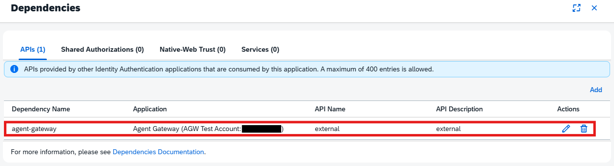

# Google Cloud Platform - SAP Agent Interoperability

This cookbook explains how to integrate agents hosted on the GCP Agent Platform or Gemini Enterprise to an agent on the **SAP Business AI Platform** through **SAP Agent Gateway**. It corresponds to the Reference Architecture [**Gemini Enterprise Integration with Joule Agents**](https://architecture.learning.sap.com/docs/ref-arch/c9a3f8).

## Architecture Overview

Connecting a GCP-hosted agent — deployed on Google's Agent Platform and surfaced through Gemini Enterprise — to an agent on the SAP Business AI Platform requires bridging two distinct trust domains.

Gemini Enterprise supports cross-provider three-legged OAuth (3LO): it can present an in-chat sign-in prompt and authenticate the user against SAP Cloud Identity Services (IAS), producing an end-user token. What neither Gemini Enterprise nor SAP offers out of the box is the subsequent token exchange needed to re-scope that token for the SAP Agent Gateway — the authoritative inbound hub for all external agent traffic on the SAP side. That second hop is why a bridge agent is needed.

**GCP-Agent-Bridge** is a transparent proxy agent that sits between Gemini Enterprise and the downstream A2A agent. It runs on Google Agent Runtime (Vertex AI Agent Engine) and is deployed with `agents-cli`. On each request it takes the end-user token forwarded by Gemini Enterprise, runs a JWT-bearer token exchange against SAP IAS — authenticating itself with a client assertion signed by the `sap-ias-signer` GCP service account via Google's signJwt API — to obtain a token scoped to the downstream resource, then relays the call to the target agent over A2A. The resulting architecture is shown below.
 

 
### SAP side - Business AI Platform (BAIP), SAP-managed
- **Joule Work** (powered by Joule) - authoring/orchestration: *Joule Studio* (build agents), *Custom Agents* (IBD), *Joule Orchestrator* (routes via Skills and A2A), *MCP Builder, Tools* (Data Products, Knowledge Graph).
- **Managed Runtimes** - host Joule Agents, Custom Agents, MCP Servers; reachable via A2A and MCP (internal).
- **Agent Gateway** - the single inbound/outbound hub for agent traffic crossing the network boundary. Externally speaks A2A; internally connects to Managed Runtimes.
- **Autonomous Suite** - SAP LoB agents/apps (Autonomous Finance, SCM, HCM, …), connected via ODATA/REST.
- **SAP Cloud & On-Premise Solutions** - backends (S/4HANA, SuccessFactors, …) over ODATA/REST.
  
### GCP side
- **Application Clients** (Mobile/Desktop/Web) - the end-user entry point.
- **Gemini Enterprise** - Google's enterprise AI assistant; the user-facing chat surface that routes requests to connected agents.
- **Bridge Agent** - a transparent proxy agent (GCP-Agent-Bridge) that performs the three-legged OAuth token exchange and forwards calls to the downstream SAP agent over A2A.
- **Agent Runtime** (Vertex AI Agent Engine) - the managed runtime that hosts and scales the Bridge Agent; deployed via `agents-cli`.
- **Google Identity Platform** - handles user authentication on the GCP side; issues the end-user token that the Bridge Agent exchanges at SAP IAS.

### Identity and Security

The integration uses a **three-legged OAuth 2.0 / OIDC flow** so that the end-user's identity is carried end-to-end from Gemini Enterprise to the SAP backend — no service-level shared secret is involved.

**Auth flow (step by step)**

1. The user opens Gemini Enterprise and tags the Bridge Agent.
2. Gemini Enterprise redirects to **SAP IAS** (the configured authorization URI) to sign the user in.
3. The user authenticates; SAP IAS issues an authorization code that Gemini Enterprise exchanges for an **end-user token** (OIDC).
4. Gemini Enterprise forwards this end-user token to the Bridge Agent with every request.
5. The Bridge Agent performs a **token exchange** at SAP IAS (`oauth2/token`): it presents the end-user token together with a **client assertion** — a short-lived JWT signed by the GCP runtime service account (`sap-ias-signer`) — instead of a static client secret.
6. SAP IAS verifies the client assertion using the JWKS endpoint of the GCP service account, then returns a **downstream-scoped token** limited to the `TOKEN_EXCHANGE_RESOURCE` (e.g. `urn:sap:identity:application:provider:name:agent-gateway`).
7. The Bridge Agent calls the **SAP Agent Gateway** over A2A, attaching the downstream-scoped token. The gateway forwards the request to the target Joule/Custom agent.

**Key security properties**

- **No static secrets on GCP**: the Bridge Agent never holds a client secret. It authenticates to SAP IAS via a signed JWT (client assertion), where the signing key lives in the GCP IAM key store.
- **Least-privilege token scoping**: the token issued in step 6 is explicitly scoped to a single downstream resource, preventing token reuse across services.
- **Runtime service account impersonation**: the Bridge Agent's runtime identity is granted `roles/iam.serviceAccountTokenCreator` on `sap-ias-signer`, so it can sign assertions without ever downloading a private key.
- **End-user identity propagation**: SAP IAS validates the original end-user identity at every token exchange, so SAP authorization policies (roles, attributes) apply per user, not per service account.
 
---
 
## Prerequisites
 
Before you begin, assign the Agent Gateway consumer system to formations. Follow the guidance in this [SAP Help Portal document](https://help.sap.com/docs/CROSS_DOMAIN_AGENTS/85abb1b3c5734138826f02d079b04975/a0465991ba964736a781c275ddd852db.html?state=DRAFT&ai=true#loioc1e0e4ef9ce145eea314bbb9e9f61514).

- SAP Business AI Components
  - SAP for Me
  - SAP Cloud Identity Services
  - Joule Work
- GCP Project
  - [Google Cloud CLI](https://docs.cloud.google.com/sdk/docs/install-sdk) or GCP Cloud Run Console
  - APIs enabled
  - Gemini Enterprise license
  - A user with the following roles:
    - Agent Identity Admin
    - Agent Identity Editor
    - Agent Identity User
    - Vertex AI User / Agent Platform User
    - Service Usage Consumer
 
---
 
## Cookbook for scenario
 
All commands are given for Windows PowerShell.
 
### Step 1 - Create a Google Cloud Service Account

Confirm that you have completed all prerequisites before continuing.

Sign in using the Google Cloud CLI.

```
gcloud auth login
```

```
gcloud auth application-default login
```

Enable the IAM Service Account Credentials API. For reference, see the [IAM Credentials API documentation](https://docs.cloud.google.com/iam/docs/reference/credentials/rest).

```
gcloud services enable iamcredentials.googleapis.com --project <your-project-id>
```

Create a Google Cloud service account. You can change the `sap-ias-signer` account ID and display name as needed.
```
gcloud iam service-accounts create sap-ias-signer --project <your-project-id> `
  --display-name "SAP IAS client-assertion signer"
```

Verify that the service account creation was successful.

```
gcloud iam service-accounts create sap-ias-signer --project <your-project-id> `
  --display-name "SAP IAS client-assertion signer"

# Expected Output:
# DISPLAY NAME                                         EMAIL                                                               DISABLED
# SAP IAS client-assertion signer                      sap-ias-signer@<your-project-id>.iam.gserviceaccount.com             False
```

This command creates only the identity. It does not yet grant roles, create or download keys, or configure the account to sign IAS client assertions.

The resulting principal is `sap-ias-signer@<your-project-id>.iam.gserviceaccount.com`. Use it later to configure the GCP-Agent-Bridge `RUNTIME_SA_EMAIL`.

### Step 2 - Configure the SAP IAS Application

Add the following redirect URIs under `Applications & Resources` &rarr; `<your-application>` &rarr; `OpenID Connect Configuration` &rarr; `Redirect` &rarr; `Add`:

- `https://vertexaisearch.cloud.google.com/oauth-redirect`
- `https://vertexaisearch.cloud.google.com/static/oauth/oauth.html`

Create credentials under `Applications & Resources` &rarr; `<your-application>` &rarr; `Client Authentication` &rarr; `Secrets` &rarr; `Add`.

Add a description and select `Application` and `OpenID` and click `Save`.

**Note down the shown credentials!**

Add the previously configured service account under `Applications & Resources` &rarr; `<your-application>` &rarr; `Client Authentication` &rarr; `JSON Web Tokens` &rarr; `Configure Trust by Issuer` &rarr; `Add`.

Complete the fields as follows:

| Variable | Value |
|-|-|
| `Description` | Enter a description. |
| `Issuer Configuration` | Manual Configuration |
| `Issuer` | `https://www.googleapis.com/service_accounts/v1/jwk/<RUNTIME_SA_URI>` |
| `JSON Web Key Set URI` | `https://www.googleapis.com/service_accounts/v1/jwk/<RUNTIME_SA_URI>` |
| `Refresh Interval` | 24 hours |
| `Corporate Identity Provider - Name` | **Leave blank!** |
| `Subject` | Client ID from the credentials created previously. |
| `Audience` | The SAP IAS tenant base URL, e.g. `https://<tenant>.accounts.ondemand.com` |
| `API Permission Groups` | **Leave blank!**

Save the configuration.

Verify that the SAP Agent Gateway is present under `Applications & Resources` &rarr; `<your-application>` &rarr; `Dependencies`. This dependency should be automatically created while creating the Formations.



The `Dependency Name` is relevant for the `TOKEN_EXCHANGE_RESOURCE` e.g. `urn:sap:identity:application:provider:name:agent-gateway` in the next step!

### Step 3 - Configure and Deploy GCP-Agent-Bridge

Copy the `.env` template:
```PowerShell
cp env.example .env
```

Set the following variables:


| Variable | Required | Value |
|---|---|---|
| `MODEL` | No | For example, `gemini-3.8-flash`. |
| `AGENT_NAME` | Yes | For example, `gcp_agent_bridge`, you also need to adjust this in the `agents-cli-manifest.yaml`! |
| `DOWNSTREAM_AGENT_URL` | Yes | The downstream A2A JSON-RPC endpoint or the Agent Gateway A2A URL. |
| `OAUTH_CLIENT_ID` | Yes | The `client_id` of the **SAP IAS application** created in step 2. |
| `OAUTH_TOKEN_HOST` | Yes | The SAP IAS tenant base URL, for example `https://<tenant>.accounts.ondemand.com`. |
| `TOKEN_EXCHANGE_RESOURCE` | Yes | The resource or audience that identifies the downstream service to IAS, for example `urn:sap:identity:application:provider:name:agent-gateway`. |
| `RUNTIME_SA_EMAIL` | Yes | The email of the GCP service account created in step 1 that signs the client assertion, for example `<sa>@<project>.iam.gserviceaccount.com`. |
| `GE_AUTH_ID` | No | Set this only when more than one Gemini Enterprise authorization is registered on the agent; it selects the forwarded token to read. |

Open the GCP-Agent-Bridge
```
cd ./<path-on-your-machine>/GCP-Agent-Bridge/
```

Install `uv`:
```
pip install uv
```

Install the Google Agents CLI:
```
uv tool install google-agents-cli
```

Deploy the agent:
```
uv sync                                           # generates uv.lock (Docker build needs it)
agents-cli deploy --project <your-project-id>     # pass .env to the runtime; do NOT set a client secret
```

### Step 4 - Add Policy Binding to Google Cloud Platform Service Account

Open the deployed agent in the Agent Registry and look out for the identity service account. Copy the service account mail, it should look like the following.

`<service-account>@gcp-sa-aiplatform-re.iam.gserviceaccount.com`

Grant the service account permission to create credentials.

```
gcloud iam service-accounts add-iam-policy-binding `
  sap-ias-signer@<your-project-id>.iam.gserviceaccount.com `
  --member "<service-account>@gcp-sa-aiplatform-re.iam.gserviceaccount.com" `
  --role roles/iam.serviceAccountTokenCreator `
  --project <your-project-id>
```

Verify the policy binding.

```
gcloud iam service-accounts get-iam-policy `
  sap-ias-signer@<your-project-id>.iam.gserviceaccount.com `
  --project <your-project-id> `
  --format="table(bindings.role, bindings.members)"

# Expected Output
# ROLE                                      MEMBERS
# ['roles/iam.serviceAccountTokenCreator']  [['serviceAccount:sap-ias-signer@<your-project-id>.iam.gserviceaccount.com']]
```

*Optional: Add yourself as a member for local testing.*

```
gcloud iam service-accounts add-iam-policy-binding `
  sap-ias-signer@<your-project-id>.iam.gserviceaccount.com `
  --member "user:<your-email>" `
  --role roles/iam.serviceAccountTokenCreator `
  --project <your-project-id>
```

### Step 5 - Integrate GCP-Agent-Bridge with Gemini Enterprise

Open the Agent Registry in Google Cloud Console, find the deployed GCP-Agent-Bridge, and open it. Under **Protocols**, note the relevant portion of the URI in the following format:

`projects/<project-number>/locations/<region>/reasoningEngines/<engine-number>`

Open Gemini Enterprise in Google Cloud Console and create an app. Once it has been created, open the app.

Add the deployed agent to Gemini Enterprise.

Select `Agents` &rarr; `Add agent` &rarr; `Custom agent via Agent Runtime` &rarr; `Add`.

Select `Add authorization` and enter the following values:

| Variable | Value |
|-|-|
| `Authorization name` | Enter a name of your choice. |
| `Client ID` | The `client_id` of the **SAP IAS application** created in step 2. |
| `Client secret` | The `client_secret` of the **SAP IAS application** created in step 2. |
| `Token URI` | `https://<tenant>.accounts.ondemand.com/oauth2/token` |
| `Authorization URI` | `https://<tenant>.accounts400.ondemand.com/oauth2/authorize?response_type=code&scope=openid`
| `PKCE verification enabled` | unchecked |
| `Use HTTP Basic authentication` | unchecked |

Select `Next` and enter the following values:

| Variable | Value |
|-|-|
| `Agent name` | Enter a name of your choice. |
| `Agent description` | Enter a description, for example: "Proxy agent that forwards requests to an SAP agent through SAP Agent Gateway." |
| `Agent Runtime reasoning engine` | Paste the URI noted at the beginning of this step, for example `projects/<project-number>/locations/<region>/reasoningEngines/<engine-number>`. |

Select `Create`.

### Step 6 - Validate the Integration

1.  Open [Gemini Enterprise]([https://console.cloud.google.com/gemini-enterprise]) or search via Console Search and select your application.
2.  Click on `Open Preview`
3.  Tag the attached Agent with `@`
4.  Send a message e.g. `"What can you do?"`
 
---
 
## Project Structure

```
02-gcp-integration/
├── README.md                                        ← This file (main cookbook)
├── images/
│   ├── architecture.drawio                          ← Editable architecture diagram source
│   ├── architecture.drawio.png                      ← Rendered architecture diagram
│   └── agw-dependency.png                           ← Agent Gateway dependency diagram
└── code/
    ├── README.md                                    ← Code documentation and request-flow diagrams
    └── gcp-agent-bridge/                            ← Gemini Enterprise → A2A proxy agent
        ├── Dockerfile                               ← Container image definition
        ├── pyproject.toml                           ← Python project dependencies
        ├── agents-cli-manifest.yaml                 ← agents-cli deployment manifest
        ├── env.example                              ← Environment variable placeholders
        ├── .gcloudignore                            ← Files excluded from GCP uploads
        ├── .gitignore                               ← Files excluded from git
        └── app/
            ├── __init__.py
            ├── agent.py                             ← Proxy agent definition
            ├── fast_api_app.py                      ← FastAPI application entry point
            ├── jwt_bearer.py                        ← RFC 7523 SA-signed client assertion minting
            └── app_utils/
                ├── a2a.py                           ← A2A client for downstream agent calls
                ├── reasoning_engine_adapter.py      ← Vertex AI Agent Engine adapter
                └── services.py                      ← Shared service helpers
```

---
 
## Known Limitations
- **Proxy Agent** - Although Gemini Enterprise allows custom agents to be added via A2A, it is not possible to configure the authentication so that tokens can be scoped to the SAP Agent Gateway. This makes a token exchange after the three-legged auth necessary, and for this reason a proxy agent (GCP-Agent-Bridge) is required for the GCP-to-SAP integration.
- **Token Caching** - The agent runs the token exchange on every request. It mints a fresh client assertion and performs a full IAS token exchange on each call. Still-valid downstream tokens are not reused, which adds some latency.
- **Non-A2A Agent Type** - While the GCP-Agent-Bridge is an A2A-capable agent that communicates downstream via A2A, it is deployed to Google's Agent Runtime through `agents-cli` as an Agent Development Kit (ADK) agent. As a result, the agent appears with the agent type `Non A2A` in Google's Agent Registry. As no information on this topic was available online, it is not guaranteed that communication between Gemini Enterprise and the GCP-Agent-Bridge uses A2A.
- **Error Handling** - The GCP-Agent-Bridge surfaces failures as chat text in Gemini Enterprise rather than as structured A2A errors. This is not the standard approach to error handling, but it makes debugging considerably easier.
 
---
 
## References

- [Gemini Enterprise Integration with Joule Agents](https://architecture.learning.sap.com/docs/ref-arch/c9a3f8)
- [SAP Agent Gatway formation prerequisite](https://help.sap.com/docs/CROSS_DOMAIN_AGENTS/85abb1b3c5734138826f02d079b04975/a0465991ba964736a781c275ddd852db.html?state=DRAFT&ai=true#loioc1e0e4ef9ce145eea314bbb9e9f61514)
- [Credentials API documentation](https://docs.cloud.google.com/iam/docs/reference/credentials/rest)
- [Google Cloud CLI](https://docs.cloud.google.com/sdk/docs/install-sdk)
- [RFC 7523 — JWT Profile for OAuth 2.0 Client Authentication and Authorization Grants](https://www.rfc-editor.org/info/rfc7523/)
- [RFC 8693 — OAuth 2.0 Token Exchange](https://www.rfc-editor.org/info/rfc8693/)
- [Authenticate using 3-legged OAuth with auth manager](https://docs.cloud.google.com/iam/docs/auth-with-3lo-v2)
- [Create and deploy an agent with Agent CLI and Agent Identity](https://docs.cloud.google.com/iam/docs/create-and-deploy-agent)
- [Build with Gemini Enterprise Agent Platform](https://docs.cloud.google.com/gemini-enterprise-agent-platform/build)
- [Agent Development Kit (ADK)](https://adk.dev/)
- [Gemini Enterprise](https://docs.cloud.google.com/gemini/enterprise/docs)
- [SAP Cloud Identity Services](https://help.sap.com/docs/cloud-identity-services)
