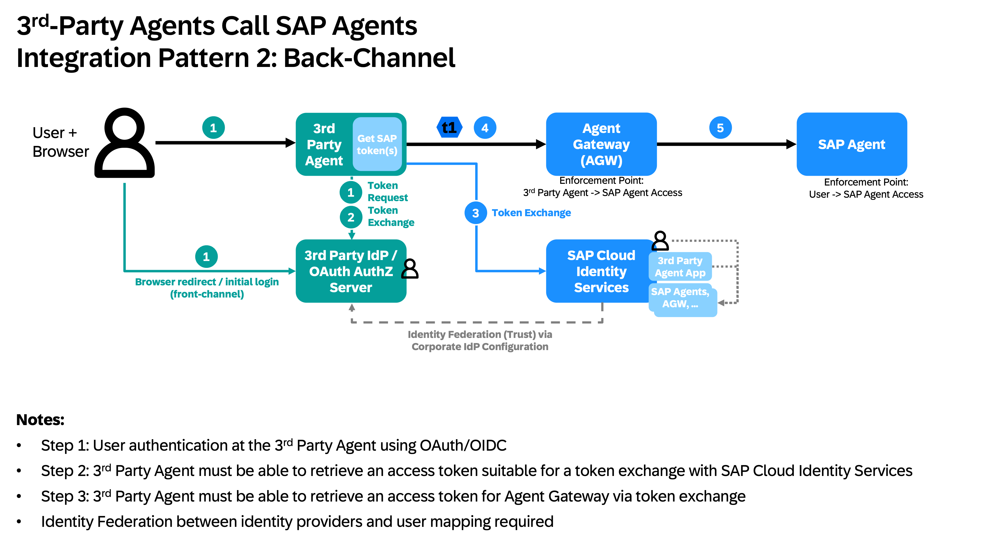

# Microsoft - SAP Agent Interoperability

This cookbook explains how to connect a Microsoft Copilot Studio agent to an agent on the **SAP Business AI Platform** through **SAP Agent Gateway**, so the Copilot agent can delegate a task and get the SAP agent's answer back - with real per-user identity. It corresponds to the Reference Architecture [**Microsoft Copilot Integration with Joule Agents**](https://architecture.learning.sap.com/docs/ref-arch/a2c0f1).

## Architecture Overview

The following diagram depict architecture components relevant for the agent integration between Microsoft and SAP Business AI Platform.

**Diagram:** [`./images/architecture.drawio`](./images/architecture.drawio)


### SAP side - Business AI Platform (BAIP), SAP-managed

- **Joule Work** (powered by Joule) - authoring/orchestration: *Joule Studio* (build agents), *Custom Agents* (IBD), *Joule Orchestrator* (routes via Skills and A2A), *MCP Builder*, *Tools* (Data Products, Knowledge Graph).
- **Managed Runtimes** - host Joule Agents, Custom Agents, MCP Servers; reachable via A2A and MCP (internal).
- **Agent Gateway** - the single inbound/outbound hub for agent traffic crossing the network boundary. Externally speaks **A2A**; internally connects to Managed Runtimes.
- **Autonomous Suite** - SAP LoB agents/apps (Autonomous Finance, SCM, HCM, …), connected via ODATA/REST.
- **SAP Cloud & On-Premise Solutions** - backends (S/4HANA, SuccessFactors, …) over ODATA/REST.

### Microsoft side - 3rd party

- **Application Clients** (Mobile/Desktop/Web) - the end-user entry point.
- **Microsoft Copilot Studio Agent** - the orchestrator; acts as an **A2A client** sending tasks to the SAP Agent Gateway across the network boundary.
- **Microsoft Entra ID** - corporate IdP; authenticates users and federates trust with SAP Cloud Identity Services.

### Identity

- **SAP Cloud Identity Services (SCI/IAS)** ↔ **Microsoft Entra ID** - bidirectional **OIDC trust** (the identity bridge between the two clouds).
- Entra authenticates end-users; the trust chain enables **principal propagation** downstream into SAP backends.

---

## Integration patterns: Front-Channel vs. Back-Channel

When a 3rd-party agent calls SAP agents on behalf of a user, there are two IAM integration patterns:

| Pattern | How the user's SAP identity is established | Browser involvement |
|---|---|---|
| **Front-Channel** (Authorization Code Grant) | The 3rd-party agent initiates an OAuth Authorization Code flow **directly with SAP Cloud Identity Services** - the user's browser is redirected to SCI/IAS for login | Browser redirected to SAP (cookie-based, potential extra attack vector) |
| **Back-Channel** (Token Exchange) | The user authenticates against the **3rd-party IdP** (e.g. Entra ID); the agent exchanges that token server-to-server with SCI - no browser redirect to SAP | No SAP browser flow; exchange happens in connector code |

**Microsoft Copilot uses the Back-Channel pattern** (Custom Connector via Power Apps). See [`./code/README.md`](./code/README.md) for a detailed explanation with architecture diagrams.

---

## Which approach?

Reminder: make sure to have completed the SAP-side **→ [Common setup](../00-common-setup/README.md)**

For calling an agent **behind the Agent Gateway** from Copilot Studio, this cookbook gives three variants:

| | Channel | What it is | Identity | Setup | Wired as |
|---|---|---|---|---|---|
| **Approach A** | **Back-Channel** | custom connector, **Entra** two-step exchange (user token → Entra app token → gateway token) | per-user | needs an Entra app registration | **Tool** |
| **Approach B** | **Back-Channel** | custom connector, **direct IAS OAuth**, single exchange | per-user | simplest - no Entra app | **Tool** |
| **Approach C** | **Front-Channel** | native **Connect Agent2Agent** for your own BTP A2A agent that accepts a plain IAS Bearer token | per-user | no gateway exchange needed | **Add agent** |

**Approach B is the recommended default** for the Agent Gateway. Approach C applies only when the endpoint accepts a plain Bearer token directly (your own BTP agent, or a middleware proxy that performs the exchange - see *Known limitations & roadmap*).

> For structured data / tool access (rather than full task delegation) the alternative is the MCP Gateway in Integration Suite - out of scope here (see *Sources*, d2e34e).

---

## Approach A - Agent Gateway (A2A) via custom connector, Entra two-step exchange

Call an SAP agent **behind the Agent Gateway** from Copilot Studio. The Gateway only accepts a token minted via a **`jwt-bearer` token exchange** against SCI:

- `assertion` = the end user's Entra token
- `client_assertion` = an Entra app token
- `resource = urn:sap:identity:application:provider:name:agent-gateway`

Copilot Studio's native A2A auth can only send one plain Bearer token (see *Known limitations & roadmap*), so the working pattern is a **Power Apps custom connector** that performs the exchange in **connector C# code** before forwarding the A2A `message/send`.

Result: real **principal propagation** - the gateway token carries the actual user (`sub`), `ias_apis: ["external"]`.

> **Custom connector = a Tool, never "Add agent".** Approaches A and B both build a Power Apps **custom connector** and attach it via **Tools → + Add a tool → Connector**. A custom connector **never** appears in the **Add agent / Connect Agent2Agent** dialog - that dialog lists only native A2A agents (with an agent card) and has **no code step**. The exchange lives in the connector's C# (Code tab), which exists only on the custom-connector/Tool path. The native "Add agent" route is **Approach C**.



### Requirements

- **Agent Gateway access** + the target agent's identifiers: base URL, agent ORD id, system/CAD artifact id.
- **SCI admin** on the third-party-agent application, plus a one-time **trust setup** (Step 2 preconditions).
- An **Entra app registration** for the connector client, with a client secret and an *Expose an API* scope (`access_as_user`).
- A **Copilot Studio** environment where custom connectors are allowed, and a user who can sign in to that Entra tenant.

### Step 1 - Gather the SAP agent details

| | Format |
|---|---|
| Agent Card (GET) | `<base>/v1/a2a/<agent-ord-id>/<cad-id>/.well-known/agent-card.json` |
| Agent (POST) | `<base>/v1/a2a/<agent-ord-id>/<cad-id>/jsonrpc` |

Confirm the raw call first in Bruno/curl (a JSON-RPC `message/send` body returns `result.artifacts[0].parts[0].text`).

### Step 2 - SCI setup: trust + authorize the end user

> **One-time precondition:** Entra is trusted as a **corporate IdP** in SCI, and the Entra app token is accepted as a **client assertion** via **Applications → <agent app> → Client Authentication → Configure Trust by Issuer** (Issuer = Entra STS `https://sts.windows.net/<tenant>/`, JWKS = `https://login.windows.net/common/discovery/keys`, Subject = Entra app `oid`, Audience = `api://<entra-app-id>`).

The gateway authorizes the **real user** at two layers - a new user is rejected until **both** grants exist. In **SCI Admin Console → Users & Authorizations → User Management**:

**2a - Make the user exist in IAS.** (Missing user → `invalid_grant: "User is not authorized for access"` at the exchange.)
- **+ Add** → name, **Email = the user's Entra email**, **Account Activation = "Set status active"** (no password/mail - login is federated). The incoming Entra token is matched to this IAS user by email.

**2b - Grant the agent's RBAC group.** (Otherwise the agent returns `state:"failed"` / **"403 RBAC: access denied"**.)
- Open a **working** user's **Groups** tab, note the agent group (e.g. `agent - Access`). Open **your** user → **Groups → Assign** → add that group.

> **Tip:** diagnose the exact SCI error in the connector's **Test** tab (Step 4) - the Response body shows the full `detail`. Copilot only surfaces the error *code*.

### Step 3 - Create the custom connector in Power Apps

> **Shortcut:** **Create → Import an OpenAPI file** and pick [`./code/agw-connector-entra.swagger.json`](./code/agw-connector-entra.swagger.json) - it scaffolds General (host/base path), the `InvokeA2A` POST action, and the OAuth security definition. After import, replace host, path IDs and scope with your own, then do 3b (secret) and 3d (code).

**3a - General:** Scheme `HTTPS`, Host `<base>`, Base URL `/`.

**3b - Security:** Authentication type **OAuth 2.0**, Identity Provider **Azure Active Directory**:

| Field | Value |
|---|---|
| Client ID | your Entra app |
| Secret options | Client secret |
| Client secret | your client secret |
| Authorization URL | `https://login.microsoftonline.com` |
| Tenant ID | your Entra tenant |
| Resource URL | `api://<your-ias-tenant>.accounts400.cloud.sap` |
| Enable on-behalf-of login | `true` |
| Scope | `api://<your-ias-tenant>.accounts400.cloud.sap/access_as_user` |

After saving, copy the generated **Redirect URL** (`https://global.consent.azure-apim.net/redirect/…`) into the Entra app's **Redirect URIs**.

**3c - Definition:** **+ New action** `InvokeA2A`. **Request → Import from sample:** Verb `POST`, **URL** = your Agent (POST) URL, **Header** `Content-Type: application/json`, **Body**:
```json
{"jsonrpc":"2.0","id":"test-1","method":"message/send","params":{"message":{"role":"user","parts":[{"kind":"text","text":"Tell me a finance joke"}],"messageId":"msg-1","kind":"message"}}}
```
Then **Add default response** (`{}` is fine). Do **not** add an `Authorization` header - the C# sets it.
> The path contains colons (`…customer.build:agent:…`). Verify it stayed one literal segment (no `{param}` generated).

**3d - Code:** toggle **Code Enabled**, select operation `InvokeA2A`, paste [`./code/agw-connector-entra.csx`](./code/agw-connector-entra.csx). In a **local-only copy** fill the placeholders (`ENTRA_CLIENT_ID`, `ENTRA_CLIENT_SECRET`, `ENTRA_TENANT_ID`, `ENTRA_SCOPE`, `SCI_TOKEN_URL`, `SCI_CLIENT_ID`); keep `SCI_RESOURCE_URN`. **Never commit real values.**

The script: (1) reads the incoming Entra user token; (2) `client_credentials` → Entra app token; (3) SCI `jwt-bearer` exchange (`assertion` = user token, `client_assertion` = app token, `resource` = agent-gateway URN) → gateway token; sets `Authorization: Bearer`, strips the Power-Platform `accept-language` header, forwards.

Then **Create / Update connector**.

### Step 4 - Test the connector (expect 200 + the result)

**Test** tab → **New connection** → sign in with your Entra user (Step 2) → **Connected**. **Raw Body = On**, paste the `message/send` body, **Test operation** → expect **HTTP 200**, `result.status.state = "completed"`, result under `result.artifacts[0].parts[0].text`.

| If you see… | Cause | Fix |
|---|---|---|
| `502 … invalid_grant "User is not authorized for access"` | user not provisioned in IAS | Step 2a |
| `200` but `state:"failed"`, `"403 RBAC: access denied"` | user not in the agent's RBAC group | Step 2b |
| `400 … "Validation failure for accept-language"` | injected header | script already strips it |
| `-32600 "Caller could not be resolved to a known tenant, cannot verify mapping to target 'CAD…'"` | server-side: no consumer/tenant→deployment mapping for that CAD (typical after a Joule-Studio re-deploy, which also **rotates the CAD id** in the URL) | SAP side re-establishes the mapping; also confirm the CAD id in your POST URL + swagger is current |
| `Invalid JSON-RPC Request` (in Copilot, not here) | `jsonrpc` serialized as `2` not `"2.0"` | use a Formula in Step 5 |

### Step 5 - Create the Copilot agent + add the tool

1. **Copilot Studio → Create → New agent** (same environment), name it, Create.
2. **Tools → + Add a tool → Connector →** your connector → `InvokeA2A` → **Add and configure** → pick the connection from Step 4.
3. **Description:** describe when to call it, e.g. *"Calls the SAP agent via SAP Agent Gateway (A2A). Use whenever the user asks for …"*
4. **Inputs:**

   | Input | Fill using | Value |
   |---|---|---|
   | `parts` | **Dynamically fill with AI** | - (the user's question) |
   | `method` | Custom value | `message/send` |
   | `jsonrpc` | **Custom value → Formula** | `"2.0"` **must be a Formula.** A plain custom value is coerced to the number `2` → gateway `"Invalid JSON-RPC Request"`. |
   | `id` | Custom value | `test-1` |
   | `messageId` | Custom value | `msg-1` |
   | `role` | Custom value | `user` |

5. **Additional details → Credentials to use = "End user credentials"** (per-user principal propagation).
6. **Agent → Overview → Instructions → Edit:**
   > When you call the tool, answer only with the text in `result.artifacts[0].parts[0].text`. If it fails or returns a connection/auth prompt, say so and do NOT invent an answer.
7. **Save.**

### Step 6 - Test from Copilot & verify authenticity

Ask the agent to use the tool.
- The **first** call per session may hit a one-time **"Let's get you connected first"** consent → **Open connection manager → Submit → Retry**.
- **Prove it's real, not hallucinated:** open the tool node in the test flow and read its Outputs.

> **Residual secret:** the Entra client secret stays in the connector C# (it can't be removed inside the connector sandbox - no managed identity reachable from ScriptBase). The secretless path is the Azure-façade roadmap in *Known limitations & roadmap*.

---

## Approach B - Agent Gateway (A2A) via custom connector, direct IAS OAuth (single exchange)

Same goal as Approach A, but the connector's OAuth connection authenticates the user **directly against SCI/IAS** instead of Entra. The connection delivers an **IAS user token**, and the connector performs a **single** `jwt-bearer` exchange (`resource=agent-gateway`) to get the gateway token.

**Why prefer this over A:** simplest setup - **no Entra app**, no Entra client-credentials step, no Entra redirect. One secret (the IAS client secret), still real **per-user principal propagation**. Use when users can authenticate at IAS directly (natively or federated into IAS).

> Still a **custom connector = a Tool** (see the box in Approach A). It does **not** go through "Add agent".

### Requirements

- **Agent Gateway access** + the agent identifiers (base URL, ORD id, CAD id).
- An **IAS application** (the agent app) with: **client ID + secret**, and **two grant types enabled** - `authorization_code` (connection sign-in) **and** `jwt-bearer` (the exchange). Add `refresh_token` + scope `offline_access` for durable connections.
- A **Copilot Studio** environment where custom connectors are allowed.
- Each user **provisioned in IAS** and in the agent's **RBAC group** (identical to Approach A Step 2a/2b).

### Step 1 - Gather the SAP agent details

Same two URLs as Approach A Step 1. Confirm the raw call in Bruno/curl first.

### Step 2 - IAS app + authorize the user

- On the IAS application, enable grant types **`authorization_code`** and **`jwt-bearer`** (+ `refresh_token` if using `offline_access`). Note the **client ID** and create/read a **client secret**.
- Provision the user and grant the agent's RBAC group - exactly as Approach A **Step 2a / 2b**.

### Step 3 - Create the custom connector

> **Shortcut:** **Create → Import an OpenAPI file** and pick [`./code/agw-connector-ias-oauth.swagger.json`](./code/agw-connector-ias-oauth.swagger.json) - it scaffolds General, the `InvokeA2A` POST action, and the IAS (Generic OAuth 2) security definition. After import, replace host, path IDs and the IAS tenant with your own, then do 3b (secret) and 3d (code).

**3a - General:** Scheme `HTTPS`, Host `<base>`, Base URL `/`.

**3b - Security:** Authentication type **OAuth 2.0**, Identity Provider **Generic Oauth 2**:

| Field | Value |
|---|---|
| Client ID | the IAS client ID |
| Client secret | the IAS client secret |
| Authorization URL | `https://<ias-tenant>.accounts400.ondemand.com/oauth2/authorize` |
| Token URL | `https://<ias-tenant>.accounts400.ondemand.com/oauth2/token` |
| Refresh URL | *(same as Token URL)* |
| Scope | `openid` (use `openid offline_access` for refresh) |

After saving, copy the generated **Redirect URL** into the IAS client's **redirect-uris** **before** the first sign-in.

**3c - Definition:** **+ New action** `InvokeA2A`, Verb `POST`, URL = your Agent (POST) URL, Header `Content-Type: application/json`, Body = the sample envelope (as Approach A Step 3c). No `Authorization` header param.

**3d - Code:** toggle **Code Enabled**, operation `InvokeA2A`, paste [`./code/agw-connector-ias-oauth.csx`](./code/agw-connector-ias-oauth.csx). In a **local-only copy** fill `IAS_TOKEN_URL`, `IAS_CLIENT_ID`, `IAS_CLIENT_SECRET`; keep `IAS_RESOURCE_URN`. **Never commit real values.**

Then **Create / Update connector**.

The script reads the IAS user token the connection delivers, does the `jwt-bearer` exchange (`resource=agent-gateway`), sets `Authorization: Bearer`, strips `accept-language`, and forwards. It does **not** rewrite the envelope - so pin `jsonrpc` as a Formula in the tool (Step 5).

### Step 4 - Test the connector

**Test** tab → **New connection** → the IAS login popup opens (Generic OAuth 2) → sign in → **Connected**. Raw Body = On, paste the `message/send` body, **Test operation** → expect **200**, `state:"completed"`, result under `result.artifacts[0].parts[0].text`.

| If you see… | Cause | Fix |
|---|---|---|
| `401 missing_user_token` | connection didn't attach a token | reconnect / confirm the OAuth connection is signed in |
| `502 ias_exchange_failed … invalid_grant` | user not provisioned / not authorized in IAS | Approach A Step 2a |
| `200` but `state:"failed"`, `403 RBAC` | user not in the agent's RBAC group | Approach A Step 2b |
| `-32600 "Caller could not be resolved to a known tenant… target 'CAD…'"` | server-side tenant→deployment mapping missing (post re-deploy) | SAP side restores the mapping; check the CAD id didn't rotate |

### Step 5 - Create the Copilot agent + add the tool

Identical to Approach A Step 5: **Tools → + Add a tool → Connector →** your connector → `InvokeA2A` → pick the connection. Inputs - `parts` = **Dynamically fill with AI**; `jsonrpc` = **Custom value → Formula** `"2.0"`; `method`=`message/send`, `id`=`test-1`, `messageId`=`msg-1`, `role`=`user`. **Credentials to use = "End user credentials."** Add the Instructions guard. **Save.**

### Step 6 - Test from Copilot

As Approach A Step 6 - ask the agent to use the tool, verify the real answer in the tool node's Outputs. First call per idle session may show a one-time connection consent - reconnect once and retry.

---

## Approach C - Native Connect Agent2Agent for a BTP A2A agent (OAuth 2.0)

Connect your own A2A agent on SAP BTP to a Copilot Studio agent, per-user via the IAS OAuth 2.0 Authorization Code flow. This works because the BTP agent validates a **plain IAS Bearer token** directly - no gateway exchange needed.

### Requirements

- A working A2A agent on SAP BTP Cloud Foundry, on a public route, serving its Agent Card at `https://<your-route>/.well-known/agent-card.json`.
- A bound IAS service instance the agent uses to validate incoming Bearer tokens; access to its service key (client ID + secret).
- A Copilot Studio agent in an environment where *Connect Agent2Agent* (preview) is enabled.

### Step 1 - Make the Agent Card Copilot-compatible

- `defaultInputModes` / `defaultOutputModes` = `text/plain` (a bare `"text"` is treated as incompatible).
- `capabilities.streaming = false` → Copilot uses the unary `message/send` (SSE `message/stream` stalls behind Copilot's APIM proxy).
- **No** `securitySchemes` / `security` block - OAuth is set on the Copilot connection (Step 3), not the card. The server still enforces the Bearer token.
- Default **JSONRPC** transport - do not set `preferredTransport`.
- **CORS** (`Access-Control-Allow-Origin`) on the public well-known paths, wrapping the auth middleware - the Connect dialog fetches the card from a browser context.

### Step 2 - Configure the IAS OAuth client

Update the IAS service instance (config only - **never put the client secret in a file**):

```bash
cf update-service <your-ias-instance> -c '{
  "oauth2-configuration": {
    "grant-types": ["authorization_code", "refresh_token"],
    "redirect-uris": ["<REDIRECT_URI_FROM_STEP_3>"],
    "token-policy": { "refresh-parallel": 1 }
  }
}'
```

- Use `authorization_code` + `refresh_token` - **not** `authorization_code_pkce_s256` (PKCE fails here).
- Allow refresh-token issuance (+ `offline_access` scope in Step 3), or the connection dies once the first access token expires.
- Read client ID / secret from the service key: `cf create-service-key <your-ias-instance> copilot-key` then `cf service-key <your-ias-instance> copilot-key`.

### Step 3 - Create the connection in Copilot Studio

**Agents → Add → Connect Agent2Agent (preview).** Agent card URL `https://<your-route>/.well-known/agent-card.json`; Authentication = **OAuth 2.0 → Authorization Code (Manual)**:

| Field | Value |
|---|---|
| Authorization URL | `https://<ias-tenant>.accounts400.ondemand.com/oauth2/authorize` |
| Token URL | `https://<ias-tenant>.accounts400.ondemand.com/oauth2/token` |
| Refresh URL | *(same as Token URL)* |
| Scopes | `openid email offline_access` |
| Client ID / Secret | from the IAS service key (Step 2) |

> **Register the redirect URI first.** Filling the form generates an agent-specific redirect URL (`https://global.consent.azure-apim.net/redirect/<connector>-<hash>`). Copy it into the IAS client's `redirect-uris` (Step 2) **before** completing consent, or the OAuth callback is rejected.

Click **Create** and complete the IAS login / consent in the popup.

### Step 4 - Add the connected agent and publish

When the connection shows **Connected**, add the agent and **Publish** the Copilot Studio agent.

### Step 5 - Test end-to-end

Ask Copilot to delegate (e.g. *"Ask <agent>: How is the weather in Berlin today?"*) - the connected agent's answer flows back into the conversation.

> **Note:** The first call in a fresh/idle session may return a generic `SystemError` with **no** request reaching BTP - that is Power Platform (APIM) warmup, not an auth error. Just resend; do not recreate the connection. A real auth failure instead shows a `401` at BTP (check `cf logs <your-app>`).

---

## Security & identity

**Entra ↔ SCI trust.** Entra and SCI share a bidirectional OIDC trust: Entra authenticates the user, SCI trusts Entra as a **corporate IdP**. That's why SCI accepts the user's Entra token as the `assertion` in the `jwt-bearer` exchange (Approach A).

**The Approach A exchange carries two tokens:**

| Token | Is | Does |
|---|---|---|
| `assertion` | the end user's **Entra token** | identifies the **user**; SCI keeps `sub` through the exchange → **principal propagation** (the agent and backend see the real user; RBAC is per user) |
| `client_assertion` | an Entra **app** token | identifies the **calling app**. App tokens can't be *exchanged*, but may be used *as* a client assertion (`docs/research/agent-identity/agent-identity.md:189`) |

In Approach B the connection delivers an IAS user token directly, so a single `jwt-bearer` exchange (no separate `client_assertion`) suffices.

**Why `resource` matters.** Only a token minted with `resource=urn:sap:identity:application:provider:name:agent-gateway` has the `aud` the gateway accepts - a plain OAuth token doesn't. That's the whole reason for the exchange.

**`ias_apis` boundary.** Customer/partner apps always get `ias_apis: ["external"]`; the `sap-internal` surface is UCL-managed and can't be self-declared.

**RBAC.** A **user** token passes the agent's RBAC (if that user is authorized). An app-only (`client_credentials`) token gets **403 "RBAC: access denied"** unless the app/Agent User has an AMS policy - so the user-scoped token is the clean path.

---

## Known limitations & roadmap

**Native A2A reaches the gateway only via a proxy.** Copilot Studio's native *Connect Agent2Agent* auth offers only None / API key / authorization_code OAuth - it can't itself perform the `jwt-bearer` exchange, and the agent card's `securitySchemes` don't drive it (MS Learn, *add-agent-agent-to-agent*). So a native A2A connection can't talk to the gateway **directly** - that's what Approaches A/B's custom connector is for. It **can**, however, point at the **Agent Gateway Middleware** (`packages/agent-gateway-middleware`): the middleware serves the agent card at `/.well-known/agent-card.json`, accepts the user's plain IAS/Entra ID token, and performs the `jwt-bearer` exchange itself before forwarding (`app/middleware/auth.py`: ID-token mode → exchange). Native A2A then stays native (SAP agent as a connected peer, not a Tool), principal propagation preserved.

**The last secret can't leave the connector.** The connector's C# sandbox has no managed identity, no IMDS/egress, no client_credentials grant on the connection, no WIF source (MS Learn: *write-code*, *connection-parameters*, *workload-identity-federation*). So the client secret in the connector can't be replaced by a managed identity *inside the connector*.

**Secretless roadmap - Azure façade.** Move the exchange to Azure compute that **has** a managed identity (API Management / Functions / Container Apps). It uses its MI (or Entra Workload Identity Federation) for client auth, does the SCI exchange, returns the token - the connector then holds **no secret** and just forwards. The repo's `packages/agent-gateway-middleware` (already does `password_grant` + `jwt_bearer_exchange`) is the natural base. SAP's documented client auth here is **JWKS / `private_key_jwt`** - see SAP Help *"Invoking an SAP Agent Through IDP Trust and JWKS-Based Integration"*.

**Other.** A2A still preview; Agent Gateway not GA; MCP Gateway path not covered (→ d2e34e). Per CPA 2026-07-03, RFC 8693 exchange for SAP→*external* egress moves to the Unified Outbound Gateway - the inbound external→SAP path in this cookbook is unaffected.

---

## Sources
- RA0029 - "A2A and MCP for Interoperability": <https://github.com/SAP/architecture-center/blob/dev/docs/ref-arch/RA0029/1-a2a-and-mcp/drawio/architecture.drawio>
- Copilot Studio × MCP Gateway (d2e34e): <https://architecture.learning.sap.com/docs/ref-arch/d2e34e>
- Pro-code A2A example (community): <https://github.com/hobru/sap-a2a-btp-copilot-studio>
- SAP Help - Invoking an SAP Agent Through IDP Trust and JWKS-Based Integration: <https://help.sap.com/docs/CROSS_DOMAIN_AGENTS/4d8be6737cf24797bf753cbcc6e2288f/e9da5158a18649168e040495b26c43bc.html>
- Copilot Studio native A2A auth options: <https://learn.microsoft.com/en-us/microsoft-copilot-studio/add-agent-agent-to-agent>
- Custom connector custom-code sandbox: <https://learn.microsoft.com/en-us/connectors/custom-connectors/write-code>
- Custom connector connection auth types: <https://learn.microsoft.com/en-us/connectors/custom-connectors/connection-parameters>
- Entra Workload Identity Federation: <https://learn.microsoft.com/en-us/entra/workload-id/workload-identity-federation>
