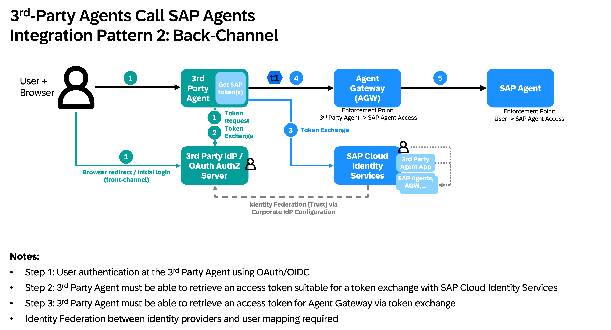

# Microsoft - SAP Agent Interoperability: Alternative Approaches

> This document covers **Approach A** and **Approach C**. The recommended default is **[Approach B](./README.md)**, documented in the main README.

---

## Approach A - SAP's agent gateway (A2A) via Custom Connector, Entra Two-Step OAuth 2.0 Token Exchange

Call an SAP agent **behind the SAP's agent gateway** from Copilot Studio using a **Power Apps custom connector** that performs a two-step OAuth 2.0 Token Exchange in connector C# code before forwarding the A2A `message/send`.

The SAP's agent gateway only accepts a token minted via a **OAuth 2.0 Token Exchange** (`jwt-bearer` grant type) against SAP Cloud Identity Services:

- `assertion` = the end user's Entra Access Token
- `client_assertion` = an Entra app Access Token
- `resource = urn:sap:identity:application:provider:name:agent-gateway`

Copilot Studio's native A2A auth can only send one plain Bearer token (see [Known Limitations](./README.md#known-limitations--roadmap)), so the custom connector performs the OAuth 2.0 Token Exchange in **connector C# code** before forwarding.

Result: real **[principal propagation](https://help.sap.com/docs/connectivity/sap-btp-connectivity-cf/principal-propagation)** - the SAP's agent gateway Access Token carries the actual user (`sub`), `ias_apis: ["external"]`.

> **A2A-marked custom connector = attached via "Add agent".** Approach A builds a Power Apps **custom connector** whose OpenAPI carries the `x-ms-agentic-protocol: a2a-1.0` marker (already in the [template swagger](./code/agw-connector-entra.swagger.json)). That marker makes the connector appear in Copilot Studio under **Agents → + Add → Select an agent in your environment**, where it is attached as a native **A2A agent** (Step 5). The two-step OAuth 2.0 Token Exchange still lives in the connector's C# (Code tab). Do **not** use **Connect to an external agent → Agent2Agent** and type the endpoint in by hand — that builds a *different* connector whose token flow is rejected with `401 Invalid JWT`.



### Prerequisites

- **SAP's agent gateway access** + the target agent's identifiers: base URL, agent ORD id, system/CAD artifact id.
- **SAP Cloud Identity Services admin** on the third-party-agent application, plus a one-time **trust setup** (Step 2 preconditions).
- Two **Entra app registrations** (one app can serve both roles if it has a secret *and* the exposed scope):
  - a **connector client app** `<ENTRA_CLIENT_APP_ID>` with a **client secret** — used for the `client_credentials` grant in the connector code; and
  - an **API app** `<ENTRA_API_APP_ID>` that exposes an *Expose an API* scope `access_as_user` — used as the OAuth **Resource** the signed-in user's token is issued for.
- A **Copilot Studio** environment where custom connectors are allowed, and a user who can sign in to that Entra tenant.

### Step 1 - Gather the SAP Agent Details

| | Format |
|---|---|
| Agent Card (GET) | `<base>/v1/a2a/<agent-ord-id>/<cad-id>/.well-known/agent-card.json` |
| Agent (POST) | `<base>/v1/a2a/<agent-ord-id>/<cad-id>/jsonrpc` |

Confirm the raw call first in Bruno/curl (a JSON-RPC `message/send` body returns `result.artifacts[0].parts[0].text`).

### Step 2 - SAP Cloud Identity Services Setup: Trust and User Authorization

> **One-time preconditions — the exchange validates TWO Entra tokens, and each needs its own trust in SAP Cloud Identity Services:**
>
> **(i) The app token (`client_assertion`)** is accepted via **Applications → \<agent app\> → Client Authentication → Configure Trust by Issuer** (Issuer = Entra STS `https://sts.windows.net/<tenant>/`, JWKS = `https://login.windows.net/common/discovery/keys`, Subject = Entra app `oid`, Audience = `api://<entra-app-id>`).
>
> **(ii) The user token (`assertion`)** requires Entra wired as a **Corporate Identity Provider** *and* explicitly trusted by the agent app — three settings that must all line up:
> - **Identity Providers → \<your Entra Corporate IdP\> → OpenID Connect Configuration:** the configured **Issuer must equal the user token's `iss`**. Entra **v2** tokens carry `https://login.microsoftonline.com/<tenant>/v2.0`, so force v2 on the connector's Entra app (**App registration → Manifest → `"requestedAccessTokenVersion": 2`**).
> - **Identity Providers → \<your Entra Corporate IdP\> → Subject Name Identifier = `Email`** — SCI maps the federated login to a local SCI user by email.
> - **Applications → \<agent app\> → Trust → Conditional Authentication → Trust Corporate Identity Providers:** the Corporate IdP must be **checked here, on the specific agent app**. Existing at tenant level is **not** enough. Missing → `No trusted corporate IdP found for token issuer`.

The SAP's agent gateway authorizes the **real user** at two layers - a new user is rejected until **both** grants exist. In **SAP Cloud Identity Services Admin Console → Users & Authorizations → User Management**:

**2a - Provision the user in SAP Cloud Identity Services.** (Missing user → `invalid_grant: "User is not authorized for access"` at the OAuth 2.0 Token Exchange.)
- **+ Add** → name, **Email = the user's Entra email**, **Account Activation = "Set status active"** (no password/mail - login is federated). The incoming Entra Access Token is matched to this SAP Cloud Identity Services user by email.
- **The match uses the token's `email` claim, which is sourced *only* from the user's primary `mail` attribute** (Entra → user → Contact Information → **Email**), **not** from "Other emails". So: (1) add `email` as an optional claim on the **Access** token (**App registration → Token configuration → Add optional claim → Access → `email`**), and (2) make sure the user's primary `mail` equals this SCI user's email. A mismatch is **not** reported as an auth error — the exchange succeeds, but the gateway then rejects the request with `400 Validation failure for user_uuid: Value may not be undefined or null` (SCI minted a token with no user context).

**2b - Grant the agent's RBAC group.** (Otherwise the agent returns `state:"failed"` / **"403 RBAC: access denied"**.)
- Open a **working** user's **Groups** tab, note the agent group (e.g. `agent - Access`). Open **your** user → **Groups → Assign** → add that group.

> **Tip:** diagnose the exact SAP Cloud Identity Services error in the connector's **Test** tab (Step 4) - the Response body shows the full `detail`. Copilot only surfaces the error *code*.

### Step 3 - Create the Custom Connector in Power Apps

> **Shortcut:** **Create → Import an OpenAPI file** and pick [`./code/agw-connector-entra.swagger.json`](./code/agw-connector-entra.swagger.json) - it scaffolds General (host/base path), the `InvokeA2A` **A2A operation** (carrying `x-ms-agentic-protocol: a2a-1.0`, so the connector is attachable via **Add agent** in Step 5), and the OAuth security definition. After import, replace the host, the path IDs, and the `api://<ENTRA_API_APP_ID>` resource/scope with your own, then do 3b (secret) and 3d (code).

**3a - General:** Scheme `HTTPS`, Host `<base>`, Base URL `/`.

**3b - Security:** Authentication type **OAuth 2.0**, Identity Provider **Azure Active Directory**:

| Field | Value |
|---|---|
| Client ID | the **connector client app** id `<ENTRA_CLIENT_APP_ID>` |
| Secret options | Client secret |
| Client secret | that app's client secret |
| Authorization URL | `https://login.microsoftonline.com` |
| Tenant ID | your Entra tenant |
| Resource URL | `api://<ENTRA_API_APP_ID>` (the API app that exposes `access_as_user`) |
| Enable on-behalf-of login | `true` |
| Scope | `api://<ENTRA_API_APP_ID>/access_as_user` |

After saving, copy the generated **Redirect URL** (`https://global.consent.azure-apim.net/redirect/…`) into the Entra app's **Redirect URIs**.

**3c - Definition:** If you imported the template swagger, `InvokeA2A` is already defined as an **A2A operation** (`x-ms-agentic-protocol: a2a-1.0`) with only `Content-Type` and `Accept-Language` **header** parameters and **no body parameter** — Copilot Studio's A2A layer builds the JSON-RPC `message/send` envelope itself. Do **not** add an `Authorization` header (the C# sets it) and do **not** add a body parameter.
> The path contains colons (`…customer.build:agent:…`). Verify it stayed one literal segment (no `{param}` generated).

**3d - Code:** toggle **Code Enabled**, select operation `InvokeA2A`, paste [`./code/agw-connector-entra.csx`](./code/agw-connector-entra.csx). In a **local-only copy** fill the placeholders — `ENTRA_CLIENT_ID` / `ENTRA_CLIENT_SECRET` are the **connector client app** `<ENTRA_CLIENT_APP_ID>` and its secret, `ENTRA_SCOPE` stays `api://<ENTRA_CLIENT_APP_ID>/.default`, plus `ENTRA_TENANT_ID`, `SCI_TOKEN_URL`, `SCI_CLIENT_ID`; keep `SCI_RESOURCE_URN`. (The API app `<ENTRA_API_APP_ID>` appears only in the swagger security, not in code.) **Never commit real values.**

The script: (1) reads the incoming Entra Access Token; (2) `client_credentials` → Entra app Access Token; (3) SAP Cloud Identity Services OAuth 2.0 Token Exchange (`assertion` = user Access Token, `client_assertion` = app Access Token, `resource` = agent-gateway URN) → SAP's agent gateway Access Token; sets `Authorization: Bearer`, strips the Power-Platform `accept-language` header, forwards.

Then **Create / Update connector**.

### Step 4 - Test the Connector

**Test** tab → **New connection** → sign in with your Entra user (Step 2) → **Connected**. **Raw Body = On**, paste the `message/send` body, **Test operation** → expect **HTTP 200**, `result.status.state = "completed"`, result under `result.artifacts[0].parts[0].text`.

| If you see… | Cause | Fix |
|---|---|---|
| `502 … invalid_grant "User is not authorized for access"` | user not provisioned in SAP Cloud Identity Services | Step 2a |
| `502 … "No trusted corporate IdP found for token issuer"` | the Corporate IdP is not checked on the agent app, or its Issuer ≠ the user token's `iss` | Step 2 precondition (ii) |
| `400 … "Validation failure for user_uuid: Value may not be undefined or null"` | user token's `email` matches no SCI user (claim absent or ≠ primary `mail`) | Step 2a |
| `200` but `state:"failed"`, `"403 RBAC: access denied"` | user not in the agent's RBAC group | Step 2b |
| `400 … "Validation failure for accept-language"` | injected header | script already strips it |
| `-32600 "Caller could not be resolved to a known tenant, cannot verify mapping to target 'CAD…'"` | server-side: no consumer/tenant→deployment mapping for that CAD (typical after a Joule-Studio re-deploy, which also **rotates the CAD id** in the URL) | SAP side re-establishes the mapping; also confirm the CAD id in your POST URL + swagger is current |
| `Entity 'connector' With Id = <guid> Does Not Exist` (in Copilot when attaching the agent) | Power-Platform sync lag after editing the connector's swagger to add the A2A markers | wait ~10–15 min and retry; the connector data is intact (the swagger still downloads). Re-import fresh only if it persists |

### Step 5 - Add the Connector as an Agent in Copilot Studio

Because the connector carries `x-ms-agentic-protocol: a2a-1.0`, it is attached as a **native A2A agent** (not as a Tool):

1. **Copilot Studio → Create → New agent** (same environment), name it, Create. Wait until provisioning finishes.
2. **Agents → + Add → Select an agent in your environment →** pick your connector (it shows an **A2A** badge). Do **not** use *Connect to an external agent → Agent2Agent*, and do **not** type the endpoint in by hand.
3. **Connection → Create new connection →** sign in with your Entra user (Step 2) → the connection turns green → **Add and configure**.
4. **Credentials to use = "End user credentials"** (per-user principal propagation).
5. **Save.** The agent now appears under **Agents**, Enabled.

> No tool inputs and no `jsonrpc` Formula are needed on this path — Copilot Studio's A2A layer builds the JSON-RPC `message/send` envelope itself, and the `accept-language` header it injects is stripped by the connector C# (Step 3d).

### Step 6 - Test from Copilot and Verify Authenticity

In the **Test your agent** panel, send a warm-up `hi`, then a real request (e.g. *"give me some motivation"*).
- The **first** call per session may hit a one-time **"Let's get you connected first"** consent → **Open connection manager → Submit → Retry**. A first attempt can also fail while the A2A connection warms up — just resend.
- **Prove it's real, not hallucinated:** the answer should carry per-user context (e.g. the signed-in user's name), and the step's **Execution summary** shows *"A2A agent execution completed"*.

> **Residual secret:** the Entra client secret stays in the connector C# (it can't be removed inside the connector sandbox - no managed identity reachable from ScriptBase). See the main [README - Known Limitations](./README.md#known-limitations).

---

## Approach C - Native Connect Agent2Agent for a BAIP A2A Agent (OAuth 2.0)

Connect your own A2A agent on SAP BAIP to a Copilot Studio agent, per-user via the SAP Cloud Identity Services OAuth 2.0 Authorization Code flow. This works because the BAIP agent validates a **plain SAP Cloud Identity Services Access Token** directly - no SAP's agent gateway OAuth 2.0 Token Exchange needed.

### Prerequisites

- A working A2A agent on SAP BAIP Cloud Foundry, on a public route, serving its Agent Card at `https://<your-route>/.well-known/agent-card.json`.
- A bound SAP Cloud Identity Services service instance the agent uses to validate incoming Bearer tokens; access to its service key (client ID + secret).
- A Copilot Studio agent in an environment where *Connect Agent2Agent* (preview) is enabled.

### Step 1 - Make the Agent Card Copilot-Compatible

- `defaultInputModes` / `defaultOutputModes` = `text/plain` (a bare `"text"` is treated as incompatible).
- `capabilities.streaming = false` → Copilot uses the unary `message/send` (SSE `message/stream` stalls behind Copilot's APIM proxy).
- **No** `securitySchemes` / `security` block - OAuth is set on the Copilot connection (Step 3), not the card. The server still enforces the Bearer token.
- Default **JSONRPC** transport - do not set `preferredTransport`.
- **CORS** (`Access-Control-Allow-Origin`) on the public well-known paths, wrapping the auth middleware - the Connect dialog fetches the card from a browser context.

### Step 2 - Configure the SAP Cloud Identity Services OAuth Client

Update the SAP Cloud Identity Services service instance (config only - **never put the client secret in a file**):

```bash
cf update-service <your-sci-instance> -c '{
  "oauth2-configuration": {
    "grant-types": ["authorization_code", "refresh_token"],
    "redirect-uris": ["<REDIRECT_URI_FROM_STEP_3>"],
    "token-policy": { "refresh-parallel": 1 }
  }
}'
```

- Use `authorization_code` + `refresh_token` - **not** `authorization_code_pkce_s256` (PKCE fails here).
- Allow refresh-token issuance (+ `offline_access` scope in Step 3), or the connection dies once the first access token expires.
- Read client ID / secret from the service key: `cf create-service-key <your-sci-instance> copilot-key` then `cf service-key <your-sci-instance> copilot-key`.

### Step 3 - Create the Connection in Copilot Studio

**Agents → Add → Connect Agent2Agent (preview).** Agent card URL `https://<your-route>/.well-known/agent-card.json`; Authentication = **OAuth 2.0 → Authorization Code (Manual)**:

| Field | Value |
|---|---|
| Authorization URL | `https://<sci-tenant>.accounts400.ondemand.com/oauth2/authorize` |
| Token URL | `https://<sci-tenant>.accounts400.ondemand.com/oauth2/token` |
| Refresh URL | *(same as Token URL)* |
| Scopes | `openid email offline_access` |
| Client ID / Secret | from the SAP Cloud Identity Services service key (Step 2) |

> **Register the redirect URI first.** Filling the form generates an agent-specific redirect URL (`https://global.consent.azure-apim.net/redirect/<connector>-<hash>`). Copy it into the SAP Cloud Identity Services application's `redirect-uris` (Step 2) **before** completing consent, or the OAuth callback is rejected.

Click **Create** and complete the SAP Cloud Identity Services login / consent in the popup.

### Step 4 - Add the Connected Agent and Publish

When the connection shows **Connected**, add the agent and **Publish** the Copilot Studio agent.

### Step 5 - Test End-to-End

Ask Copilot to delegate (e.g. *"Ask \<agent\>: How is the weather in Berlin today?"*) - the connected agent's answer flows back into the conversation.

> **Note:** The first call in a fresh/idle session may return a generic `SystemError` with **no** request reaching BAIP - that is Power Platform (APIM) warmup, not an auth error. Just resend; do not recreate the connection. A real auth failure instead shows a `401` at BAIP (check `cf logs <your-app>`).
