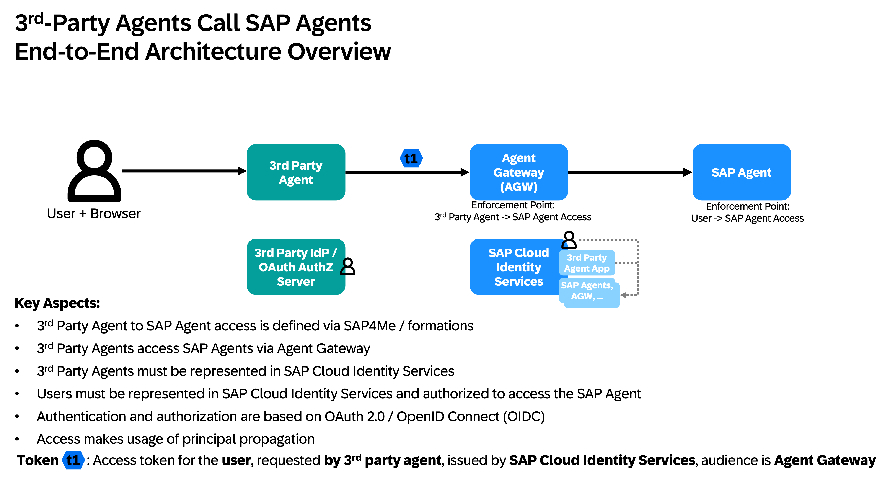
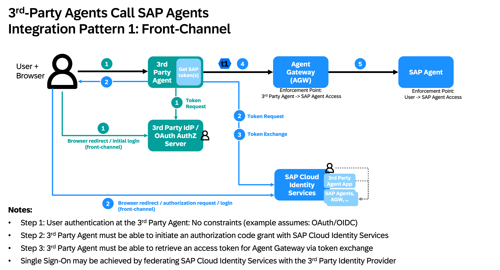
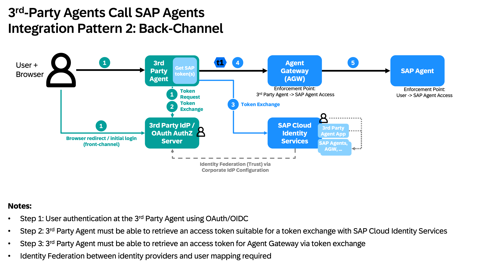

# Microsoft Copilot Studio - Connector Code

This directory contains the custom connector code (C# scripts) and OpenAPI definitions for integrating Microsoft Copilot Studio with SAP agents via the agent gateway.

For the full step-by-step setup guide see [`../README.md`](../README.md).

---

## Integration Patterns: Front-Channel vs. Back-Channel

When a 3rd-party agent (e.g. Microsoft Copilot) calls SAP agents on behalf of a user, there are two IAM integration patterns for how the user's identity is passed to SAP:

### End-to-End Architecture

The user interacts with the 3rd-party agent; the agent calls the **agent gateway** which enforces access at two points: the 3rd-party agent's right to call SAP agents, and the user's right to access the specific SAP agent. Authentication and authorization are based on OAuth 2.0 / OpenID Connect (OIDC) with [principal propagation](https://help.sap.com/docs/connectivity/sap-btp-connectivity-cf/principal-propagation).

---

### Path 1 - Front-Channel (Authorization Code Grant)

The 3rd-party agent initiates an **OAuth Authorization Code Grant directly with SAP Cloud Identity Services**. The user's browser is redirected to SAP Cloud Identity Services for login and consent, which produces an SAP Cloud Identity Services Access Token for the agent gateway.

**Flow:**
1. User logs in to the 3rd-party agent (e.g. via OAuth/OIDC at the third-party Identity Provider)
2. The agent initiates an Authorization Code Grant at **SAP Cloud Identity Services** (browser redirect)
3. SAP Cloud Identity Services issues an Access Token; the agent exchanges it for an agent gateway Access Token via OAuth 2.0 Token Exchange
4. The agent gateway Access Token is used to call the SAP Agent

**Characteristics:**
- Connection is configured natively in the 3rd-party platform (e.g. Copilot Studio's connection wizard)
- The user sees a browser login popup / redirect to SAP during the connection setup
- Authentication goes through the browser - **potential additional attack vector** (cookie in browser)
- No pre-configured identity federation between the IdPs required (but SSO via federation is possible)
- Straightforward if the 3rd-party platform natively supports Authorization Code Grant against SAP Cloud Identity Services

**Examples:** Google Gemini Enterprise → Front-Channel via Custom Agent Runtime; **Microsoft Copilot, Approach B** → Front-Channel via Custom Connector (SAP Cloud Identity Services OAuth, single OAuth 2.0 Token Exchange)

---

### Path 2 - Back-Channel (Token Exchange)

The 3rd-party agent authenticates the user against its **own Identity Provider** (e.g. Microsoft Entra ID) and then exchanges that token **server-to-server** with SAP Cloud Identity Services - **no browser redirect to SAP**. Requires pre-configured identity federation (trust) between the third-party Identity Provider and SAP Cloud Identity Services.

**Flow:**
1. User logs in to the 3rd-party agent via the third-party Identity Provider (e.g. Entra ID, browser front-channel)
2. The agent requests a token from its own Identity Provider and performs an OAuth 2.0 Token Exchange server-to-server
3. The third-party Identity Provider exchanges the token with **SAP Cloud Identity Services** via the configured federation trust
4. The agent uses the SAP Cloud Identity Services-issued Access Token to call the agent gateway

**Characteristics:**
- No browser redirect to SAP; the SAP auth flow is fully server-side
- Requires identity federation (trust) configured in advance between the third-party Identity Provider and SAP Cloud Identity Services
- More resilient: no additional browser-based SAP auth flow, no browser cookies for the SAP leg
- Requires that the third-party Identity Provider/OAuth Server supports token exchange (RFC 8693)

**Example:** **Microsoft Copilot, Approach A** → Back-Channel via Custom Connector (Entra two-step OAuth 2.0 Token Exchange)

> **Microsoft Copilot's recommended default (Approach B) uses the Front-Channel pattern** via a Power Apps Custom Connector.
> The user's browser is redirected to SAP Cloud Identity Services during connector sign-in; the connector code then performs the server-side OAuth 2.0 Token Exchange.

---

## Files in this directory

| File | Approach | Channel | Description |
|---|---|---|---|
| [`agw-connector-entra.csx`](./agw-connector-entra.csx) | [Approach A](../README.md#approach-a---agent-gateway-a2a-via-custom-connector-entra-two-step-exchange) | **Back-Channel** | Connector C# script: Entra Access Token → Entra app Access Token → SAP Cloud Identity Services OAuth 2.0 Token Exchange → agent gateway |
| [`agw-connector-entra.swagger.json`](./agw-connector-entra.swagger.json) | [Approach A](../README.md#approach-a---agent-gateway-a2a-via-custom-connector-entra-two-step-exchange) | Back-Channel | OpenAPI definition - import into Power Apps to scaffold the connector |
| [`agw-connector-ias-oauth.csx`](./agw-connector-ias-oauth.csx) | [Approach B](../README.md#approach-b---agent-gateway-a2a-via-custom-connector-direct-ias-oauth-single-exchange) | **Front-Channel** | Connector C# script: SAP Cloud Identity Services Access Token → SAP Cloud Identity Services OAuth 2.0 Token Exchange → agent gateway (single OAuth 2.0 Token Exchange, no Entra) |
| [`agw-connector-ias-oauth.swagger.json`](./agw-connector-ias-oauth.swagger.json) | [Approach B](../README.md#approach-b---agent-gateway-a2a-via-custom-connector-direct-ias-oauth-single-exchange) | Front-Channel | OpenAPI definition - import into Power Apps to scaffold the connector |

Approach A follows the **Back-Channel** pattern: the user-facing browser flow is against Entra ID; the SAP OAuth 2.0 Token Exchange happens server-side in the connector code. Approach B follows the **Front-Channel** pattern: the user's browser is redirected to SAP Cloud Identity Services during connector sign-in; the OAuth 2.0 Token Exchange is still server-side, but the user authenticates directly at SAP.
