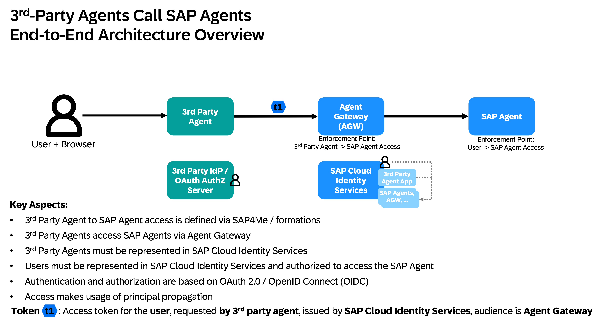
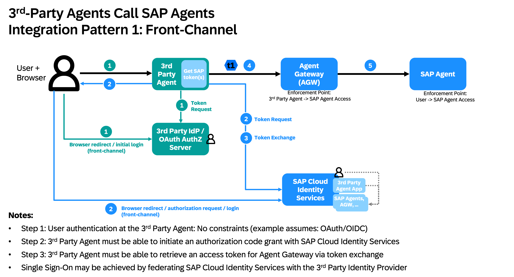
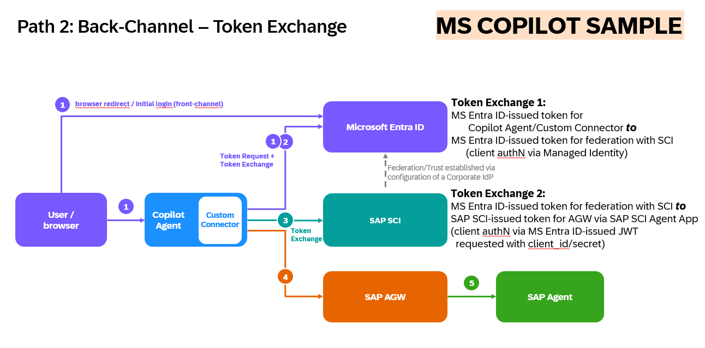

# Microsoft Copilot Studio – Connector Code

This directory contains the custom connector code (C# scripts) and OpenAPI definitions for integrating Microsoft Copilot Studio with SAP agents via the SAP Agent Gateway.

For the full step-by-step setup guide see [`../README.md`](../README.md).

---

## Integration Patterns: Front-Channel vs. Back-Channel

When a 3rd-party agent (e.g. Microsoft Copilot) calls SAP agents on behalf of a user, there are two IAM integration patterns for how the user's identity is passed to SAP:

### End-to-End Architecture

The user interacts with the 3rd-party agent; the agent calls the SAP **Agent Gateway (AGW)** which enforces access at two points: the 3rd-party agent's right to call SAP agents, and the user's right to access the specific SAP agent. Authentication and authorization are based on OAuth 2.0 / OpenID Connect (OIDC) with principal propagation.

---

### Path 1 – Front-Channel (Authorization Code Grant)

The 3rd-party agent initiates an **OAuth Authorization Code Grant directly with SAP Cloud Identity Services (SCI)**. The user's browser is redirected to SCI/IAS for login and consent, which produces an SCI token for the Agent Gateway.

**Flow:**
1. User logs in to the 3rd-party agent (e.g. via OAuth/OIDC at the 3rd-party IdP)
2. The agent initiates an Authorization Code Grant at **SAP Cloud Identity Services** (browser redirect)
3. SCI issues a token; the agent exchanges it for an AGW-scoped token via Token Exchange
4. The AGW token is used to call the SAP Agent

**Characteristics:**
- Connection is configured natively in the 3rd-party platform (e.g. Copilot Studio's connection wizard)
- The user sees a browser login popup / redirect to SAP during the connection setup
- Authentication goes through the browser – **potential additional attack vector** (cookie in browser)
- No pre-configured identity federation between the IdPs required (but SSO via federation is possible)
- Straightforward if the 3rd-party platform natively supports Authorization Code Grant against SCI

**Example:** Google Gemini Enterprise → Front-Channel via Custom Agent Runtime

---

### Path 2 – Back-Channel (Token Exchange)

The 3rd-party agent authenticates the user against its **own IdP** (e.g. Microsoft Entra ID) and then exchanges that token **server-to-server** with SAP Cloud Identity Services – **no browser redirect to SAP**. Requires pre-configured identity federation (trust) between the 3rd-party IdP and SCI.

**Flow:**
1. User logs in to the 3rd-party agent via the 3rd-party IdP (e.g. Entra ID, browser front-channel)
2. The agent requests a token from its own IdP and does a Token Exchange server-to-server
3. The 3rd-party IdP exchanges the token with **SAP Cloud Identity Services** via the configured federation trust
4. The agent uses the SCI-issued token to call the AGW

**Characteristics:**
- Implemented as a **Power Apps Custom Connector** – the token exchange happens in C# connector code
- No browser redirect to SAP; the SAP auth flow is fully server-side
- Requires identity federation (trust) configured in advance between the 3rd-party IdP and SCI
- More resilient: no additional browser-based SAP auth flow, no browser cookies for the SAP leg
- Requires that the 3rd-party IdP/OAuth Server supports token exchange (RFC 8693)

> **Microsoft Copilot uses the Back-Channel pattern** via a Power Apps Custom Connector.
> The connector code in this directory implements the server-side `jwt-bearer` token exchange.

---

## Files in this directory

| File | Approach | Channel | Description |
|---|---|---|---|
| [`agw-connector-entra.csx`](./agw-connector-entra.csx) | [Approach A](../README.md#approach-a---agent-gateway-a2a-via-custom-connector-entra-two-step-exchange) | **Back-Channel** | Connector C# script: Entra user token → Entra app token → SCI `jwt-bearer` exchange → AGW |
| [`agw-connector-entra.swagger.json`](./agw-connector-entra.swagger.json) | Approach A | Back-Channel | OpenAPI definition – import into Power Apps to scaffold the connector |
| [`agw-connector-ias-oauth.csx`](./agw-connector-ias-oauth.csx) | [Approach B](../README.md#approach-b---agent-gateway-a2a-via-custom-connector-direct-ias-oauth-single-exchange) | **Back-Channel** | Connector C# script: IAS user token → SCI `jwt-bearer` exchange → AGW (single exchange, no Entra) |
| [`agw-connector-ias-oauth.swagger.json`](./agw-connector-ias-oauth.swagger.json) | Approach B | Back-Channel | OpenAPI definition – import into Power Apps to scaffold the connector |

**Approach B is the recommended default** – no Entra app registration needed, simplest setup, still full per-user principal propagation.

Both Approach A and B follow the **Back-Channel** pattern: the user-facing browser flow is against the 3rd-party IdP only; the SAP token exchange happens server-side in the connector code.
